# Browser flow and evidence reference

This is the single flow from the supplied diagram, expressed in Mermaid. The config check happens before the browser opens. The browser starts at `/login` for an existing configured account, or `/signup` when no account pair is configured.

```mermaid
flowchart LR
    Start((Start)) --> Config["Check .agents/.env with a non-printing allowlisted loader"]
    Config --> Account{Complete test account pair exists?}
    Account -->|Yes| Login["Open /login and sign in"]
    Account -->|No| Signup["Open /signup and create the account"]
    Signup --> Login
    Login --> Google{Use Google sign-in?}
    Google -->|Yes| Provider["Continue with Google and wait for provider"]
    Google -->|No| Feature["Continue with the requested feature"]
    Provider --> Chooser{Visible Google account chooser?}
    Chooser -->|Yes| Select["Select the first visible account"]
    Chooser -->|No| User["Pause in browser for user sign-in"]
    Select --> Callback["Return through NalaGrow callback"]
    User --> Callback
    Callback --> Home{Authenticated dashboard visible?}
    Feature --> Home
    Home -->|Yes| Result["Assert /dashboard and its visible greeting"]
    Home -->|No| Error["Keep the real error or onboarding route visible"]
    Result --> Hold["Pause on the real dashboard for inspection"]
```



## Flow details

| State | Required behavior and evidence |
| --- | --- |
| Config check | Load only the selected email/password keys from `.agents/.env` into the current Bash process. Do not source the file or print values. |
| Account exists | Open `/login`, assert the `Welcome back` heading and labelled fields, then use the selected sign-in method. The default method is password. |
| Account missing | Open `/signup` and pause in the visible browser. Complete signup and sign-in in the real UI, including any required Terms acceptance. Resume only after reaching the authenticated app. |
| Password sign-in | Submit the loaded account once. Assert `/dashboard` and its visible greeting, reload, and assert the same destination again. |
| Google sign-in | Click `Continue with Google`. If an account chooser with visible account rows appears, select the first visible row. If Google needs a manual sign-in step, continue in the paused browser. |
| Authenticated home | The expected route is `/dashboard`. A `/profile/create` route means onboarding is still required; do not create profile data for the test. |
| Browser result | The main spec pauses on the real dashboard after reload. The browser remains open until the user resumes Playwright or closes the browser. On failure, it pauses on the actual failure state. |
| Callback and recovery | `casdoor-session-regressions.spec.ts` contains route and handoff checks only. Those are regression evidence, not proof of a successful login. |

## Focused headed run

The project README documents the frontend at `http://localhost:3000`. Confirm that the real services are running before using this URL. Keep `E2E_SERVICES_EXTERNAL=1` so Playwright does not reclaim ports or start disposable services. Local runs use a visible browser and pause on the result page. Tracing, screenshots, and video stay disabled.

In the same Bash terminal, load only the selected account pair. These commands do not print the values:

```bash
NALA_GROW_E2E_EMAIL="$(grep -m1 '^TEST_ACCOUNT_EMAIL_3=' .agents/.env | cut -d= -f2- | tr -d '\r')"
NALA_GROW_E2E_PASSWORD="$(grep -m1 '^TEST_ACCOUNT_PASSWORD_3=' .agents/.env | cut -d= -f2- | tr -d '\r')"
export NALA_GROW_E2E_EMAIL NALA_GROW_E2E_PASSWORD
```

Run the password sign-in flow:

```bash
E2E_SERVICES_EXTERNAL=1 BASE_URL=http://localhost:3000 NALA_GROW_E2E_INTERACTIVE=1 NALA_GROW_E2E_SIGN_IN_METHOD=password npm --prefix frontend run test:e2e -- --project=desktop --headed --reporter=dot --trace=off e2e/casdoor-session.spec.ts
status=$?
printf 'Playwright exit=%s\n' "$status"
```

To follow the Google branch, run the same flow with `NALA_GROW_E2E_SIGN_IN_METHOD=google`:

```bash
E2E_SERVICES_EXTERNAL=1 BASE_URL=http://localhost:3000 NALA_GROW_E2E_INTERACTIVE=1 NALA_GROW_E2E_SIGN_IN_METHOD=google npm --prefix frontend run test:e2e -- --project=desktop --headed --reporter=dot --trace=off e2e/casdoor-session.spec.ts
status=$?
printf 'Playwright exit=%s\n' "$status"
```

The target command's immediate exit status is printed after it returns. While Playwright is paused, the live page is the evidence: inspect the dashboard or error in the browser before resuming. Do not treat a provider redirect, terminal text, a mocked route, or a skipped test as a successful login.

## Evidence limits

- **Passed:** the real `/dashboard` and greeting were visible after sign-in and reload.
- **Failed:** an assertion failed or the account remained on login with a visible error.
- **Blocked:** Vault, Casdoor, or another required real service prevented the flow.
- **Not run:** account setup or another user action was required but not completed.
- **Regression-only:** a direct callback or recovery route check ran without a successful provider login.

Never report an unrun or redirected-only flow as a successful login. Keep OAuth URLs, query values, credentials, tokens, and request bodies out of output and artifacts.
