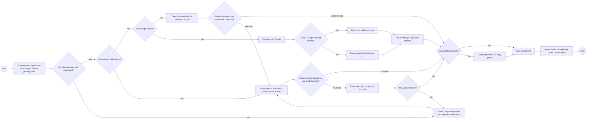

# Browser flow and evidence reference

This is the single flow from the supplied diagram, expressed in Mermaid. The config check happens before the browser opens. Password login is tried first unless signup is explicitly selected; a visible login rejection falls back to signup automatically.



## Flow details

| State | Required behavior and evidence |
| --- | --- |
| Config check | Load only `TEST_ACCOUNT_EMAIL_3` and `TEST_ACCOUNT_PASSWORD_3` from `.agents/.env`. Do not source the file or print values. |
| Password login | Submit the configured account once. If the login form shows an error, automatically continue to signup with that account. |
| Signup | Fill email/password automatically. If the configured account is absent, use a unique disposable `example.test` account. If Casdoor says the email already exists, retry login once. |
| Terms acceptance | The signup checkbox submits agreement to NalaGrow's Terms and Privacy Policy. Set `NALA_GROW_E2E_ACCEPT_TERMS=1` only for a run with explicit user authorization; do not persist this flag. |
| Required profile | If post-signup onboarding routes to `/profile/create`, create a synthetic E2E baby profile with no real child data, then open `/dashboard`. |
| Google sign-in | Click `Continue with Google`. Select the first visible `[data-identifier]` account row when the chooser appears. Pause only if Google requires a manual sign-in screen. |
| Browser result | Use `--headed`; no pause occurs at signup, password login, error, or dashboard. The visible browser shows the actual route while the test runs. |
| Success | Assert `/dashboard` and its visible greeting, reload, and assert the same destination again. |
| Callback and recovery | `casdoor-session-regressions.spec.ts` contains route and handoff checks only; they do not prove successful login. |

## Focused headed run

The project README documents the frontend at `http://localhost:3000`. Confirm the real services are running before using this URL. Keep `E2E_SERVICES_EXTERNAL=1` so Playwright does not reclaim ports or start disposable services. Run the primary spec without `--grep`; the old callback/recovery grep titles are not in this file and select zero tests.

In the same Bash terminal, load only the selected account pair. These commands do not print the values:

```bash
NALA_GROW_E2E_EMAIL="$(grep -m1 '^TEST_ACCOUNT_EMAIL_3=' .agents/.env | cut -d= -f2- | tr -d '\r')"
NALA_GROW_E2E_PASSWORD="$(grep -m1 '^TEST_ACCOUNT_PASSWORD_3=' .agents/.env | cut -d= -f2- | tr -d '\r')"
export NALA_GROW_E2E_EMAIL NALA_GROW_E2E_PASSWORD
```

Run the password flow with automatic signup fallback. Include the Terms flag only after the user has authorized it for this run:

```bash
E2E_SERVICES_EXTERNAL=1 BASE_URL=http://localhost:3000 NALA_GROW_E2E_SIGN_IN_METHOD=password NALA_GROW_E2E_ACCEPT_TERMS=1 npm --prefix frontend run test:e2e -- --project=desktop --headed --reporter=dot --trace=off e2e/casdoor-session.spec.ts
status=$?
printf 'Playwright exit=%s\n' "$status"
```

To start directly with signup after a known login failure, add `NALA_GROW_E2E_START_WITH_SIGNUP=1`:

```bash
E2E_SERVICES_EXTERNAL=1 BASE_URL=http://localhost:3000 NALA_GROW_E2E_SIGN_IN_METHOD=password NALA_GROW_E2E_START_WITH_SIGNUP=1 NALA_GROW_E2E_ACCEPT_TERMS=1 npm --prefix frontend run test:e2e -- --project=desktop --headed --reporter=dot --trace=off e2e/casdoor-session.spec.ts
status=$?
printf 'Playwright exit=%s\n' "$status"
```

To follow the Google branch, use `NALA_GROW_E2E_SIGN_IN_METHOD=google` and omit signup-only flags:

```bash
E2E_SERVICES_EXTERNAL=1 BASE_URL=http://localhost:3000 NALA_GROW_E2E_SIGN_IN_METHOD=google npm --prefix frontend run test:e2e -- --project=desktop --headed --reporter=dot --trace=off e2e/casdoor-session.spec.ts
status=$?
printf 'Playwright exit=%s\n' "$status"
```

The target command's immediate exit status is printed after it returns. A provider redirect, terminal message, mocked route, skipped test, or onboarding page alone is not proof of successful login. Never report an unrun or redirected-only flow as passed. Keep OAuth URLs, query values, credentials, tokens, and request bodies out of output and artifacts.
